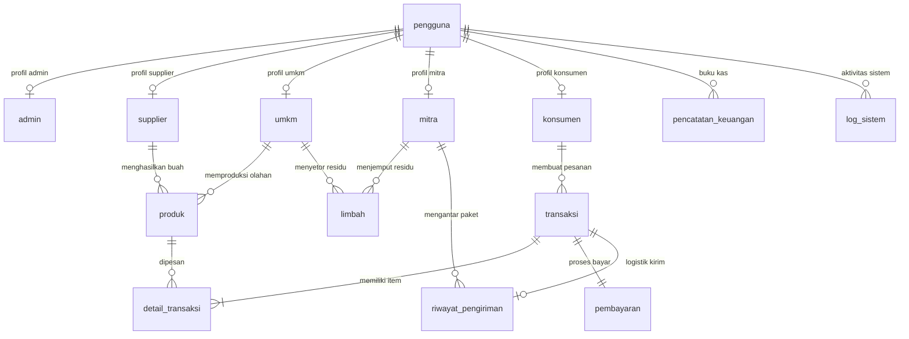

# 🥭 SAMANGGA

**Sistem Manajemen Rantai Pasok Terpadu & Pasar Sirkular Mangga Indramayu**

[](https://nextjs.org/)
[](https://react.dev/)
[](https://www.typescriptlang.org/)
[](https://tailwindcss.com/)
[](https://www.prisma.io/)
[](https://www.postgresql.org/)

---

## 📖 Tentang Platform SAMANGGA

**SAMANGGA** adalah platform web B2B rantai pasok dan ekonomi sirkular komoditas buah mangga khas Indramayu (Gedong Gincu, Arumanis, Cengkir, Golek). Platform ini mengintegrasikan seluruh alur rantai pasok dari hulu ke hilir—mulai dari petani kebun, UMKM pengolah makanan/minuman, pabrik pengolahan residu limbah (*bio-refinery*), kurir logistik distribusi, hingga konsumen grosir maupun ritel.

Selain tata kelola perdagangan komoditas, SAMANGGA menghadirkan **Pasar Limbah Sirkular** yang memungkinkan UMKM menyetorkan residu kupasan (kulit dan biji mangga) untuk dijemput oleh Mitra Pengolah menjadi pupuk kompos organik, media maggot BSF, dan pektin industri—menciptakan ekosistem berprinsip *zero waste* dan nilai tambah ekonomi bagi para pelaku agribisnis.

---

## 👥 5 Aktor Utama Ekosistem

1. **🛠️ Admin Sistem (*Command Center*)**: Bertanggung jawab atas verifikasi legalitas mitra, kurasi dan moderasi produk komoditas/olahan, validasi limbah sirkular, dan audit trail log sistem keamanan.
2. **🧑‍🌾 Supplier (*Petani & Pengepul*)**: Menjual komoditas buah mangga segar berstandar mutu per kwintal/kg, menerima pesanan, mengonfirmasi bukti transfer pembayaran, serta membeli sarana produksi tani sirkular.
3. **🏭 UMKM Pengolah**: Membeli bahan baku buah mangga segar dari petani, menjual produk bernilai tambah (dodol, puree beku, sirup, keripik), mendaftarkan residu kulit/biji ke Pasar Sirkular, dan mengelola kas usaha.
4. **♻️ Mitra (*Pengolah Residu Sirkular & Logistik*)**: Menjemput limbah kupasan mangga dari UMKM, mengolahnya menjadi produk sirkular (pupuk kompos, bibit), serta mengelola armada logistik dan resi pengiriman rantai pasok.
5. **🛒 Konsumen (*Grosir, Horeka, & Ritel*)**: Menjelajahi katalog buah segar dan produk kemasan UMKM, melakukan pemesanan dengan fleksibilitas kuantitas, memilih metode pembayaran (QRIS, VA, Transfer), dan melacak status kurir.

---

## 🔑 Kredensial Akun Demo Pengujian

Semua akun bawaan di bawah ini siap digunakan untuk keperluan peninjauan dan pengujian (*testing*):

* **Password Default Seluruh Akun:** `samangga2026`
* **Shortcut Admin UI di Form Login:** Email otomatis terisi dengan password demo `admin123`.

| Peran (Role) | Entitas / Pengguna | ID User | Email Login | Password Default | Status Akun |
|:---|:---|:---:|:---|:---:|:---:|
| **Admin Sistem** | Dr. Raka Pratama, M.Kom. | `505` | `admin.pusat@samangga.id` | `samangga2026` *(UI: `admin123`)* | **Terverifikasi** |
| **Supplier (Petani)** | H. Agus Supriyadi *(KT Sumber Rejeki)* | `101` | `agus.sumberrejeki@samangga.id` | `samangga2026` | **Terverifikasi** |
| **Supplier (Pengepul)** | H. Kartono *(UD Pengepul Mangga Jatibarang)* | `102` | `kartono.pengepul@samangga.id` | `samangga2026` | **Menunggu** *(Restricted)* |
| **UMKM Pengolah** | Hj. Ningsih Rahmawati *(Dapur Mangga Bu Ning)* | `202` | `dapur.buning@samangga.id` | `samangga2026` | **Terverifikasi** |
| **UMKM Pengolah** | Siti Masitoh *(Keripik Mangga Barokah)* | `203` | `keripik.barokah@samangga.id` | `samangga2026` | **Terverifikasi** |
| **Mitra (Limbah & Logistik)** | Ir. Hendra Kusuma *(CV Bio Tani Lestari)* | `303` | `operasional@biotanipantura.id` | `samangga2026` | **Terverifikasi** |
| **Mitra (Limbah Baru)** | Bambang Sudirja *(CV Pantura Bio Organik)* | `304` | `pantura.bio@samangga.id` | `samangga2026` | **Menunggu** *(Restricted)* |
| **Konsumen (Grosir/Ritel)** | Budi Santoso *(PT Segar Buah Nusantara)* | `404` | `purchasing@segarbuah.co.id` | `samangga2026` | **Terverifikasi** |

> [!NOTE]
> Akun berstatus **Menunggu** (misal: *H. Kartono* dan *Bambang Sudirja*) memiliki pembatasan operasional sesuai tata kelola platform: notifikasi visual peringatan verifikasi ditampilkan di portal, serta aksi terbit produk / klaim penjemputan dinonaktifkan sementara hingga diverifikasi oleh Admin.

---

## 🗄️ Skema Database PostgreSQL (14 Model ERD)

Arsitektur database dirancang relasional dan dinormalisasi ke dalam 14 model tabel (tersedia pada `be/prisma/schema.prisma` dan `samangga_database.sql`):



### Matriks Akses Operasional CRUD

| Tabel ERD | Admin Sistem | Supplier (Petani/Pengepul) | UMKM Pengolah | Mitra Sirkular & Logistik | Konsumen (Ritel/Grosir) |
|:---|:---:|:---:|:---:|:---:|:---:|
| **`pengguna`** | C, R, U, D | R, U *(profil)* | R, U *(profil)* | R, U *(profil)* | R, U *(profil)* |
| **`admin`** | C, R, U, D | - | - | - | - |
| **`supplier`** | C, R, U, D | R, U *(data supplier)* | - | - | - |
| **`umkm`** | C, R, U, D | - | R, U *(data umkm)* | - | - |
| **`mitra`** | C, R, U, D | - | - | R, U *(data mitra)* | - |
| **`konsumen`** | C, R, U, D | - | - | - | R, U *(data konsumen)* |
| **`produk`** | R, U *(moderasi)*, D | C, R, U, D *(milik)* | C, R, U, D *(milik)* | C, R, U, D *(sirkular)* | R *(katalog publik)* |
| **`limbah`** | R, U *(verifikasi)*, D | R *(pasar sirkular)* | C, R, U, D *(milik)* | R, U *(jemput limbah)* | - |
| **`transaksi` & `detail`** | R, U *(status)*, D | C, R, U *(jual/beli)* | C, R, U *(jual/beli)* | R *(logistik)* | C, R *(pesanan)* |
| **`pembayaran`** | R, U, D | R, U *(verif transfer)* | R, U *(verif transfer)* | R *(terkait)* | C, R, U *(bukti transfer)* |
| **`riwayat_pengiriman`** | R, U, D | R *(lacak paket)* | R *(lacak paket)* | C, R, U *(update resi)* | R, U *(konfirmasi tiba)* |
| **`pencatatan_keuangan`**| R *(audit kas)* | C, R, U *(buku kas)* | C, R, U *(buku kas)* | C, R, U *(buku kas)* | C, R *(buku belanja)* |
| **`log_sistem`** | C, R, D *(audit trail)* | - *(sistem otomatis)* | - *(sistem otomatis)* | - *(sistem otomatis)* | - *(sistem otomatis)* |

---

## 🚀 Panduan Menjalankan Aplikasi

### 1. Prasyarat Sistem
* Node.js v20+ atau v22+
* npm atau pnpm
* PostgreSQL (opsional untuk menjalankan instance lokal backend database)

### 2. Frontend (Next.js App Router)
```bash
# Instal dependensi frontend
npm install

# Jalankan server pengembangan (default http://localhost:3000)
npm run dev

# Jalankan kompilasi produksi
npm run build

# Menjalankan hasil build produksi
npm start
```

### 3. Backend REST API (Express + Prisma TSX)
```bash
# Masuk ke folder backend
cd be

# Instal dependensi backend
npm install

# Generate Prisma Client
npm run prisma:generate

# Jalankan pengujian otomatis REST API (26 skenario)
npm test

# Jalankan pengujian query Prisma ORM
npm run test:prisma

# Jalankan server backend (default http://localhost:5000)
npm run dev
```

---

## 📁 Struktur Direktori Repositori

```text
samangga/
├── be/                                # Layanan Backend REST API (Express + Prisma TSX)
│   ├── db/                            # Skrip Database, Migrasi DDL, & Seed Data
│   ├── prisma/
│   │   └── schema.prisma              # Skema Prisma ORM 14 Tabel PostgreSQL
│   ├── scripts/                       # Skrip Uji API Otomatis & Verifikasi Prisma
│   ├── src/                           # Controllers, Services, & Routes Backend
│   └── README.md                      # Dokumentasi Teknis Backend REST API
├── src/                               # Aplikasi Frontend Next.js (App Router)
│   ├── app/                           # Struktur Routing Halaman Next.js
│   │   ├── (auth)/login               # Halaman Masuk Akun Multi-Role
│   │   ├── daftar                     # Formulir Pendaftaran Mitra Baru
│   │   ├── fungsi/[role]              # Halaman Operasional Alur Kerja Role
│   │   ├── katalog/                   # Etalase Produk & Checkout Pemesanan
│   │   ├── keranjang/                 # Keranjang Belanja Komoditas/Olahan
│   │   ├── pasar-sirkular/            # Bursa Limbah, Setor Residu, & Jemput Limbah
│   │   ├── profil/[role]              # Portal Dashboard Profil & Status ERD
│   │   └── tentang/                   # Edukasi Ekosistem Mangga Indramayu
│   ├── components/                    # Komponen Antarmuka Reusable & Interaktif
│   ├── data/                          # Mock Data & State Awal Relasional ERD
│   ├── lib/                           # Helper Sesi Autentikasi & Utilitas
│   └── types/                         # Definisi Interface TypeScript ERD
├── samangga_database.sql              # Skrip SQL DDL Lengkap 14 Tabel Database
├── README_SAMANGGA.md                 # Rangkuman Detail Akun & Izin Akses Peran
└── README.md                          # Dokumentasi Utama Repositori SAMANGGA
```

---

## 🛡️ Jaminan Mutu & Hasil Pengujian (Quality Assurance)

Platform SAMANGGA telah melalui serangkaian pengujian *end-to-end* dan *smoke testing* otomatis dengan 0 error kompilasi:
* **Form Pendaftaran (`/daftar`):** Validasi lengkap data mitra, pemilihan peran adaptif di seluruh resolusi layar (*viewport*), dan persetujuan syarat & ketentuan.
* **Keamanan Akun:** Restriksi operasional terisolasi untuk akun yang belum lolos verifikasi administrator (`Menunggu`).
* **Pasar Limbah Sirkular (`/pasar-sirkular`):** Validasi batas minimal berat residu (>= 1 kg) dan penguncian tanggal penjemputan dinamis (*anti-lampau*).
* **Pemesanan & Transaksi (`/katalog/pesan-sekarang`):** Dukungan alamat dwi-bahasa, kalkulasi tanggal estimasi tiba dinamis, serta kalkulasi harga *real-time* saat mengubah kuantitas item.

---

## 📚 Tautan Dokumentasi Terkait
* [Dokumentasi Lengkap Akun Demo & Hak Akses Peran](file:///home/diding/Documents/LOMBA_WEB/samangga/README_SAMANGGA.md)
* [Dokumentasi Teknis Backend REST API](file:///home/diding/Documents/LOMBA_WEB/samangga/be/README.md)
